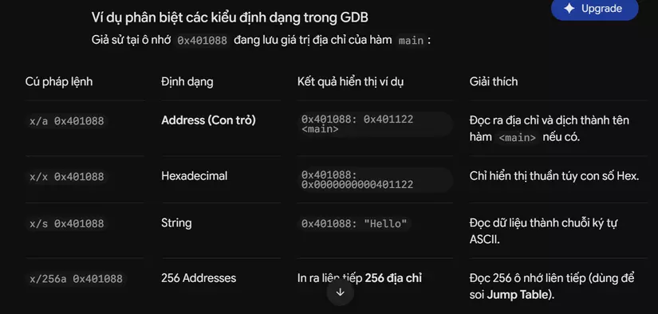

## Debug GDB
Để dịch ngược file thực thi thành mã asm:
~~~
objdump -d -M intel tên_file_thực_thi
~~~

Để bắt đầu GDB
~~~
gdb /path/to/binary/file
~~~
- Chạy `starti` để bắt đầu chương trình
- Thoát GDB: sử dụng `quit` or `q` command
- `disassemble` sẽ hợp dược mã hợp ngữ giống như `objdump`
- Thực thi từng câu lệnh đơn trong GDB, sử dụng `stepi` or `si` command

Hiển thị giá trị
- `print $rdi`: Hiển thị giá trị đang chứa trong thanh ghi rdi

Thay đổi giá trị của thanh ghi khi chương trình tạm dừng: `set $rax = 42`

### x command
Sử dụng `x` cho phép ta xem nội dung của bộ nhớ

Ví dụ:
~~~
x $rsp
~~~

- `x` mặc định hiển thị giá trị thập lục phân -> Để hiển thị thập phân ta dùng `x/d $rsp`
- `x/s` hiển thị chuỗi string: `x/s <address>`

- `x/a` được dùng để đọc và hiển thị nội dung của ô nhớ dưới dạng địa chỉ.

Cú pháp tổng quát lệnh kiểm tra bộ nhớ trong GDB:
~~~
x/[Số_lượng][Định_dạng] [Địa_chỉ]
~~~

  

### Hai cách thức dừng chương trình để gỡ lỗi trong GDB
- Preemptive Debugging: GDB chủ động can thiệp và ép chương trình phải tạm dừng tại một địa chỉ bộ nhớ do người dùng chỉ định trước.
- Cooperative Debugging: Bản thân chương trình tự chủ động cài lệnh dừng (`int3`) vào mã nguồn. Khi chạy đến đó, nó "phát tín hiệu" yêu cầu Debugger tạm dừng lại để lập trình viên kiểm tra

### Run với tham số
Nếu chương trình ta debug cần truyền tham số vào để hoạt động ta làm như sau
~~~
(gdb) run hello world
~~~

Bất cứ thứ gì ta viết sau `run` command đều trở thành tham số truyền vào chương trình (`argv[1]`, `argv[2]`, `argv[3]`)

### Chuyển hướng đầu vào GDB
GDB cũng có thể nhận các tham số từ `stdin`