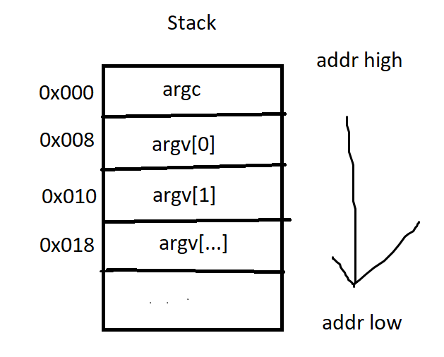

## Tổng quan về Stack & tham số truyền vào (x86-64 Linux)
Stack là vùng nhớ được cấp phát khi một chương trình chạy. 

Thanh ghi `rsp` (Stack Pointer) luôn trỏ tới **đỉnh Stack** và giá trị địa chỉ của nó sẽ **giảm dần** (di chuyển từ địa chỉ cao xuống địa chỉ thấp) khi có dữ liệu mới được đẩy (`push`) vào.

Trong kiến trúc x86-64 trong Linux, vị trí đầu tiên của stack chứa số lượng tham số truyền vào chương trình trước khi được khởi chạy (`argc`)

  

Nhìn vào hình vẽ ta sẽ cùng phân tích:
- `rsp` lúc khởi chạy sẽ trỏ vào địa chỉ `0x000` (trong TH ví dụ này là đỉnh của stack). Khi ta sử dụng `[rsp]` nghĩa là giải tham chiếu để lấy giá trị tại ô nhớ `0x000`

Ví dụ:
~~~asm
mov rax, [rsp]; -> rax = argc
~~~
- Mỗi ngăn của stack dều cách nhau là 8 ô địa chỉ (offset = 8). Bởi vì đa số các trường hợp data (địa chỉ or dữ liệu) đêu có kích thước là 8 bytes (64 bit).

Ví dụ:
~~~asm
[rsp]       = [0x000]      -> argc
[rsp + 8]   = [0x000 + 8]  -> argv[0]
[rsp + 16]  = [0x000 + 16] -> argv[1]
~~~

### Tại thời điểm khởi chạy chương trình
Ngay khi chương trình chạy bắt đầu tại nhãn `_main` hay `_start`  trong các chương trình asm. Tại thời điểm này, CPU vừa được kernel trao quyền điều khiển. Lúc này
- [rsp] chính là giá trị argc (số nguyên 64-bit chỉ số lượng tham số truyền vào)

Ví dụ: Nếu ta chạy chương trình
~~~
./program hello world
~~~

~~~asm
mov rax, [rsp]; rax sẽ nhận giá trị là 3 (bao gồm ./program, hello, world)
~~~

Lưu ý: Tên chương trình cũng là tham số truyền vào

### Tham số chương trình nằm trên stack
~~~
       Register   │   Contents
   +─────────────────────────────+
   │      rsp     │   1337000    │─┐
   +─────────────────────────────+ │
                                   │
  ┌────────────────────────────────┘
  │
  │    Address    │ Contents
  │  +────────────────────────+
  │  │ ...        │ ...       │
  │  +────────────────────────+
  └▸ │ 1337000    │ 2         │  ◀── Giả trị argc được lưu trữ ở đầu stack khi chương vừa được chạy
     +────────────────────────+
     │ 1337008    │ 1234000   │──────┐
     +────────────────────────+      │
     │ 1337016    │ 1234560   │────┐ │
     +────────────────────────+    │ │
     │ 1337024    │ 0         │    │ │
     +────────────────────────+    │ │
                                   │ │
   ┌───────────────────────────────┘ │
   │                                 │
   │   Address   │ Contents          │
   │ +──────────────────────────+    │
   │ │ 1234000   │ "/tmp/..."   │◀───┘ the program name
   │ +──────────────────────────+
   │ │ ...       │ ...          │
   │ +──────────────────────────+
   └▸│ 1234560   │ "Hi"         │ the first argument!
     +──────────────────────────+
~~~

Ngay sau ngăn xếp đầu tiên chứa số lượng tham số chương trình `argc`, stack chứa các con trỏ (các địa chỉ của tham số) trỏ đến các vùng nhớ chứa dữ liệu thật